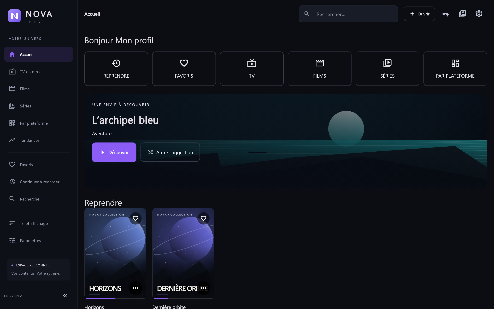

# NOVA IPTV

Lecteur IPTV natif pour **Windows et Android**, développé avec Flutter. NOVA réunit la TV en direct, les films, les séries et la reprise de lecture dans une interface sombre adaptée à la souris, au tactile et à la télécommande. Windows et le téléphone utilisent libmpv ; l'application TV utilise Media3 avec un rendu vidéo Android natif.

**TV : 0.10.2+34** · **Android téléphone : 0.10.2+34** · **Windows x64 : 0.10.2+34** · **GPL-3.0-or-later**

**Version 0.10.2+34 — Mise à jour de l’application** : une nouvelle entrée des paramètres vérifie GitHub et choisit automatiquement l'installable correspondant à Windows, au téléphone ou à l'édition TV/Fire TV. Sur Android, l'APK est téléchargée avec progression, vérifiée puis ouverte dans l'installateur système. Windows ouvre le téléchargement du ZIP portable. Les releases partielles sont prises en compte et aucune vérification réseau ne se lance au démarrage. Installer cette version une première fois manuellement pour disposer du bouton des mises à jour suivantes. [Release 0.10.2](https://github.com/Kyrluh/NOVA/releases/tag/v0.10.2) · [Notes de version](docs/RELEASE-0.10.2.md) · [Utilisation et validation](docs/MISES-A-JOUR-0.10.2.md).

**Guide automatique 0.10.1** : à l'ouverture d'une chaîne, NOVA charge le guide de sa source en arrière-plan. Le programme en cours, sa progression et le suivant apparaissent **dans l'image avec l'ATH**, puis disparaissent avec les commandes, y compris en plein écran. Les chaînes d'une même source partagent leur chargement et leur cache de session ; une indisponibilité du guide ne bloque pas la lecture. Xtream utilise le guide du fournisseur ; une M3U doit annoncer ou avoir une URL XMLTV configurée. [Télécharger la version 0.10.1](https://github.com/Kyrluh/NOVA/releases/tag/v0.10.1) · [Notes et validation](docs/RELEASE-0.10.1.md).

**NOVA IPTV 0.10.0 : interface adaptée à Windows, Android mobile et TV.** Windows propose des accès fixes aux sources, au profil et aux paramètres, ainsi que **Ctrl+F/Ctrl+K** pour la recherche. Le mobile dispose d'un accueil compact, d'un menu **Plus** organisé et d'un retour adapté à Android ; les grilles exploitent le grand écran du Fold. Les catégories sont recherchables, les filtres conservés pendant la session, les actions de lecture placées avant les synopsis et les réglages regroupés par usage. La TV reçoit une navigation à la télécommande plus directe et des fiches compactes. La release fournit le **portable Windows**, les **APK téléphone ARM64 et universelle**, l'**APK TV universelle dédiée**, les sources et les empreintes SHA-256. [Télécharger la version 0.10.0](https://github.com/Kyrluh/NOVA/releases/tag/v0.10.0) · [Notes de version](docs/RELEASE-0.10.0.md) · [Validation Windows/mobile](docs/INTERFACE-WINDOWS-MOBILE-0.10.0.md) · [Validation TV](docs/INTERFACE-TV-0.10.0.md).

**NOVA IPTV TV 0.9.2** améliore le lecteur Android TV/Fire OS, la réactivité des catalogues et la navigation à la télécommande. Les sous-titres sont désactivés au démarrage de chaque vidéo, chaîne ou épisode ; ils restent activables manuellement. Les profils, sources, favoris, reprises et préférences sont conservés lors d'une mise à jour installée par-dessus l'ancienne version. [Télécharger l'APK TV](https://github.com/Kyrluh/NOVA/releases/download/v0.9.2/NOVA-IPTV-TV-0.9.2-universal.apk) · [Notes de version et validation](docs/TV-VALIDATION-0.9.2.md).

Le lecteur TV utilise **Media3 ExoPlayer avec une SurfaceView native**. Les informations du flux affichent moteur, codecs, décodeurs et réception de la première image. La reconnaissance HLS/DASH peut récupérer certains flux dont l'URL n'indique pas le format, avec une seule tentative adaptée après une erreur de conteneur.

**Menu** affiche les commandes lorsqu'elles sont masquées, puis affiche/masque les informations lorsqu'elles sont visibles. **Retour** ferme les panneaux et commandes avant d'arrêter la chaîne et de revenir à sa liste. Les quatre boutons du direct restent réactualisation, pause/lecture, format et plein écran.

La bibliothèque réutilise les listes, catégories et résultats filtrés. Les sauvegardes de progression normale sont regroupées sur cinq secondes ; les changements d'épisode, déplacements et fins restent immédiats. Les synopsis sont enregistrés séparément pour éviter de réécrire tout le catalogue. Cette release fournit uniquement l'APK TV ; les binaires Windows et téléphone restent en **0.8.8**.


**Chargement 0.8.8** : un écran d'attente avec progression précède les profils et les catalogues au démarrage. L'import et l'actualisation manuelle ont aussi leur écran d'attente, puis rendent la main au formulaire. Sur Android, la sauvegarde chiffre le catalogue par fragments sans construire une deuxième copie JSON complète. La version TV limite également le cache d'affiches pour laisser de la mémoire au lecteur. [Validation 0.8.8](docs/VALIDATION-0.8.8.md).

**Télécommande 0.8.7** : les recherches TV ouvrent le clavier uniquement avec OK. En direct, haut/bas change de chaîne et gauche/droite parcourt les commandes. OK quand les commandes sont masquées ouvre le panneau de chaînes en plein écran (catégories avec gauche/droite, chaînes avec haut/bas). La barre du direct conserve réactualisation, pause/lecture, format et plein écran. En VOD, maintenir avance/retour accélère progressivement ; les déplacements sont regroupés sur toutes les versions. Android utilise aussi des réglages de rattrapage vidéo sur l'horloge audio après un déplacement. [Validation et limites 0.8.7](docs/VALIDATION-0.8.7.md).

**Reprise 0.8.6** : ouvrir une série positionne sa fiche sur la saison et l'épisode en cours, avec défilement automatique et repère « À reprendre ». Un seul épisode reçoit ce repère ; il suit la progression et disparaît lorsque le dernier épisode regardé est terminé, sans remettre un ancien épisode en évidence. Fonction disponible sur Windows, Android et TV. [Validation 0.8.6](docs/VALIDATION-0.8.6.md).

**NOVA IPTV TV** est une APK dédiée à la télécommande, distincte de l'application téléphone : menu latéral, focus visible, liste des chaînes et lecteur côte à côte, saisons/épisodes, commandes OK et flèches, touches multimédias et ajout de sources adapté au clavier TV. Elle cible **Android TV/Google TV** et **Fire OS à partir d'API24** ; les appareils Vega ne peuvent pas installer cette APK Android. [Installation et compatibilité TV](docs/ANDROID-TV.md).

Le correctif **Android 0.6.6** améliore la saisie des sources à la télécommande : actions Suivant/Valider du clavier, navigation haut/bas entre les champs et sélection du bouton Ajouter. [Rapport du correctif](docs/ANDROID-VALIDATION-0.6.6.md).

NOVA lit les sources personnelles configurées par l'utilisateur. Aucun abonnement, compte IPTV, chaîne commerciale ou playlist n'est fourni. Il n'y a ni publicité, ni compte NOVA, ni télémétrie applicative.



## Fonctionnalités

**Préréglage 0.8.5** : les nouvelles installations et les nouveaux profils reprennent les choix de langues et de catégories du préréglage Windows du propriétaire : TV **18 langues / 52 catégories masquées**, Films **4 / 8**, Séries **3 / 12**. Les noms des catégories sont adaptés aux identifiants de la source importée sur chaque appareil ; aucun compte ni identifiant privé d'installation n'est fourni. Les catégories sont initialisées une seule fois par source et type de contenu. Chacun peut ensuite recocher dans **Tri et affichage → Langues visibles / Catégories**, et ses choix restent conservés après actualisation et redémarrage. Les préférences déjà enregistrées ne sont pas remplacées. [Validation 0.8.5](docs/VALIDATION-0.8.5.md).

**Correctif TV 0.8.4** : l'ancien ordre alphabétique est remplacé une fois par **Ordre de la source**, séparément dans chaque profil de l'APK TV. Les filtres, favoris et reprises sont conservés. Le choix **Ordre des chaînes** est désormais directement accessible dans TV en direct ; un choix manuel effectué après la correction reste mémorisé. Cette mise à jour reconstruit uniquement l'APK TV/Fire Stick ; téléphone et Windows restent en 0.8.3. [Validation TV 0.8.4](docs/TV-VALIDATION-0.8.4.md).

**Affichage 0.8.3** : dans **Paramètres → Affiches par ligne · Films et Séries**, choisir **Automatique ou 1 à 12** sur Windows, téléphone et TV. Le choix est enregistré par profil et s'applique aux grilles de catalogue, y compris les favoris et résultats concernés. NOVA réduit le nombre sur une largeur trop petite pour préserver la lisibilité ; la préférence reste mémorisée pour retrouver la densité demandée sur un grand écran. En mode TV, les grandes cartes restent limitées à la hauteur visible pour conserver la navigation à la télécommande. Les carrousels gardent leur réglage de taille habituel.

Le contrôle ciblé TV de cette version couvre navigation, sources, fiches/épisodes, commandes du lecteur et affichage. Il a permis de sécuriser un cas d'identifiants répétés dans les versions d'une œuvre, qui pouvait casser le sélecteur d'une fiche. **Treize scénarios ciblés passent**, sans suite complète ni émulateur ; aucune TV physique n'était connectée. [Rapport 0.8.3](docs/VALIDATION-0.8.3.md).

**Nouveautés 0.8.2** : dans les sources, les flèches choisissent le champ sans ouvrir le clavier. **OK** ouvre la saisie **Android native** pour l'URL, le nom, l'identifiant, le mot de passe personnalisé ou le guide XMLTV ; **Valider** applique la valeur, **Annuler/Retour** conserve la précédente. Le clavier système ne partage plus les raccourcis du formulaire Flutter. La version 0.8.2 ajoute aussi sur Windows et téléphone une liste des sept serveurs Xtream proposés, avec Saisir une autre URL ; le dernier texte personnalisé est conservé quand on change de choix. [Validation TV 0.8.2](docs/TV-VALIDATION-0.8.2.md).

**Correctif 0.8.1** : le bandeau de retrait de Continuer à regarder disparaît après quatre secondes ; Annuler restaure l'élément et une croix permet de fermer le message. Dans Ajouter une source, **Xtream Codes** est premier et sélectionné par défaut. Le fournisseur **Kyrlu** propose **MDP prédéfini** ou **Autre · saisir un mot de passe** ; les M3U restent sans identifiants Xtream. Le préréglage des installables est fourni par une configuration locale ignorée par Git, sans identifiant réel dans le code public. [Validation 0.8.1](docs/VALIDATION-0.8.1.md).

**Nouveautés 0.8.0** : choix et création de profils au lancement ; favoris, reprises, historique, réglages, tri et genres préférés séparés par profil. Les anciennes données sont conservées dans **Mon profil** et les sources IPTV restent communes. Les genres sont proposés à la première entrée dans chaque profil et modifiables dans **Paramètres → Profil**.

Le nouvel **Accueil** propose une bannière de film aléatoire selon les genres préférés, un bouton **Autre suggestion**, les accès **Reprendre, Favoris, TV, Films, Séries, Par plateforme**, les paramètres en haut à droite et le changement de profil. Si les sources ne contiennent pas de genre correspondant, NOVA propose les autres films disponibles. L'ancien accueil est conservé dans **Tendances**, immédiatement après **Par plateforme**, sans sections Reprendre/Favoris ni raccourcis TV/vitesse.

**Par plateforme** ajoute **CANAL+, STARZ, OCS, VARIETY, TF1+ | M6+ | FTV, DOCUMENTAIRES, ÉMISSION / REALITY TV et KIDS**. KIDS reconnaît les catégories animés/animées/animation. Ces nouvelles rubriques utilisent les catégories locales et les associations manuelles ; elles ne supposent pas une API publique pour chaque service.

Les variantes d'un même film ou d'une même série peuvent partager **une fiche**, avec un choix **Version · langue / qualité** avant lecture sur Windows, téléphone et TV. Le regroupement exige une identité fiable : même source, même type, même titre normalisé et même année connue. Les remakes, sources différentes et titres sans année fiable restent séparés. Les identifiants, flux et progressions des versions sont conservés ; les variantes masquées par vos filtres ne réapparaissent pas. [Validation et limites 0.8.0](docs/VALIDATION-0.8.0.md).

Depuis **0.7.2**, le tri **Récemment ajoutés** est aussi celui par défaut dans **toutes les catégories de Films et Séries** : Horreur, Comédie, etc., sur Windows, téléphone et TV. Dans l'interface Windows/téléphone, le menu Trier par propose toujours l'ordre du catalogue, les titres et les années. [Validation 0.7.2](docs/VALIDATION-0.7.2.md).

La version **0.7.1** ajoute **Récemment ajoutés** sous **Reprendre** à l'accueil, ainsi qu'en **première catégorie, sélectionnée à l'ouverture**, dans les onglets Films et Séries. Les titres sont classés du plus récemment ajouté au plus ancien, en respectant les filtres de bibliothèque. Xtream utilise le champ fournisseur `added` lorsqu'il est valide. Pour une M3U sans dates, NOVA conserve la première apparition des titres à partir de cette version ; l'ancien cache utilise sa date d'actualisation comme point de départ, avec l'ordre du catalogue en cas d'égalité. Une actualisation ou l'ajout d'épisodes ne remet pas une série existante en tête. [Validation 0.7.1](docs/VALIDATION-0.7.1.md).

| Domaine | Prise en charge |
| --- | --- |
| Sources | M3U/M3U8 par URL ou fichier, Xtream Codes, plusieurs sources |
| TV | Direct, catégories, favoris, recherche et guide XMLTV |
| Films et séries | Fiches, saisons, épisodes, progression individuelle, épisodes précédent/suivant |
| Séries M3U | Regroupement par série et saison, y compris les noms comme `From S01 E08` |
| Bibliothèque | Accueil, recherche globale, historique, favoris et reprise de lecture |
| Tri | Ordre de la source, titres, années, catégories personnalisées, langues et groupes masquables |
| Plateformes | Classement local, associations manuelles et sélections publiques facultatives sans clé API |
| Actualisation | Mise à jour des sources au lancement, barre d'avancement et cache conservé en cas d'échec |
| Vidéo | Lecture/pause centrale, volume, luminosité, vitesse VOD, audio, sous-titres texte, format et plein écran |
| Windows | Raccourcis clavier, touches multimédias, molette pour le volume, plein écran sans bordures |
| Android | Navigation compacte/tablette, pliables, gestes configurables, Picture-in-Picture si disponible |

## Installer et mettre à jour

Les installables Windows, téléphone et TV sont disponibles dans la [**release 0.10.2**](https://github.com/Kyrluh/NOVA/releases/tag/v0.10.2). Le dépôt Git contient le **code source et la documentation** ; les binaires sont distribués séparément dans les releases. Les clés privées et les outils locaux restent hors Git.

| Plateforme | Téléchargement |
| --- | --- |
| Windows x64 portable | [ZIP Windows](https://github.com/Kyrluh/NOVA/releases/download/v0.10.2/NOVA-IPTV-0.10.2-windows-x64.zip) |
| Android TV / Google TV / Fire OS compatible | [APK TV universelle dédiée](https://github.com/Kyrluh/NOVA/releases/download/v0.10.2/NOVA-IPTV-TV-0.10.2-universal.apk) |
| Android ARM64, notamment Galaxy Z Fold | [APK ARM64](https://github.com/Kyrluh/NOVA/releases/download/v0.10.2/NOVA-IPTV-0.10.2-arm64-v8a.apk) |
| Android universelle : ARM64, ARM32, x86_64 | [APK universelle](https://github.com/Kyrluh/NOVA/releases/download/v0.10.2/NOVA-IPTV-0.10.2-universal.apk) |

Les [empreintes SHA-256 de la version 0.10.2](https://github.com/Kyrluh/NOVA/releases/download/v0.10.2/SHA256SUMS.txt) couvrent les archives et APK de cette release. Les compilations locales produisent leurs installables dans `dist/`, `dist/android/` ou `dist/android-tv/`.

### Windows

1. Extraire **tout** le ZIP dans un dossier accessible en écriture.
2. Conserver `data` et toutes les DLL à côté de `NOVA_IPTV.exe`.
3. Lancer `NOVA_IPTV.exe`.

Flutter, Visual Studio et le mode développeur ne sont pas nécessaires pour utiliser le programme compilé. Pour une mise à jour, fermer l'ancienne version puis ouvrir celle du nouveau dossier portable. Les données utilisateur restent dans le même emplacement de support Windows.

### Android

1. Copier l'APK adaptée au téléphone et l'ouvrir depuis le gestionnaire de fichiers.
2. Autoriser ce gestionnaire à installer l'APK lorsque Android le demande.
3. Ouvrir NOVA et ajouter ses sources.

Pour mettre à jour, **installer par-dessus la version précédente, sans désinstaller**. La nouvelle APK doit conserver le package `app.nova.iptv` et la même signature. Les variantes ARM64 et universelle partagent la même signature et le même code de version.

Les comptes chiffrés Windows ne sont pas transférés automatiquement sur Android : renseigner les sources sur chaque appareil. Voir [l'installation Android et la sauvegarde de la signature](docs/ANDROID-INSTALLATION.md).

### TV et Fire TV Stick

Installer l'APK **NOVA-IPTV-TV**, dont le package est `app.nova.iptv.tv`. Elle apparaît comme **NOVA IPTV TV** dans le lanceur et peut cohabiter avec l'application téléphone `app.nova.iptv`. **Les données sont séparées : renseigner les sources dans l'application TV.** Les mises à jour ultérieures de l'APK TV s'installent par-dessus celle-ci, avec la signature conservée.

Voir [le guide TV](docs/ANDROID-TV.md) pour les commandes de télécommande et la distinction Fire OS/Vega.

## Ajouter une source

1. Ouvrir **Mes sources IPTV** dans l'en-tête Windows, **Plus → Mes sources IPTV** sur Android compact, ou **Sources** dans l'en-tête TV. Les paramètres proposent aussi **Sources et guide TV → Gérer les sources**.
2. Choisir **Playlist M3U · URL**, **Playlist M3U · Fichier local** ou **Xtream Codes**.
3. Donner un nom à la source et renseigner son adresse. Pour Xtream, ajouter les identifiants du fournisseur.
4. Ajouter une URL XMLTV dans la partie guide TV si nécessaire.
5. Choisir **Ajouter** pour importer et enregistrer. **Tester la connexion** vérifie l'accès sans sauvegarder la source.

Le premier import remplace la démonstration par la bibliothèque personnelle. Les sources peuvent ensuite être modifiées, actualisées ou supprimées depuis leur fiche.

### Séries M3U

Les noms comme `From S01 E08`, `S01E08`, `1x08` ou `Saison 1 Episode 8`, ainsi que les attributs de la playlist, permettent le parcours **série → saison → épisode**. Les entrées déclarées séries/animés avec un titre identique sont réunies ; sans numérotation fournie, l'ordre de la playlist est conservé dans une seule saison.

NOVA ne peut pas déduire des saisons absentes des noms et métadonnées. Les langues, catégories et sources distinctes restent séparées. Le regroupement du cache existant conserve les identifiants des vidéos pour retrouver progressions et favoris.

## Actualisation au démarrage

À chaque **nouveau lancement de l'application**, NOVA :

1. Affiche un écran de chargement et ouvre le catalogue enregistré.
2. Actualise les sources configurées, l'une après l'autre.
3. Affiche la source et les étapes **connexion → téléchargement → classement → enregistrement**, puis propose les profils et la bibliothèque.

La barre tient compte des octets reçus lorsque le serveur annonce leur total, puis des étapes de traitement et du nombre de sources. Quand la taille est inconnue, elle reste animée pendant la réception. Le pourcentage ne représente pas un temps restant.

En cas d'échec, le dernier catalogue valide reste disponible et les autres sources continuent. Un résultat non bloquant indique les sources indisponibles. L'actualisation manuelle reste accessible via **Gérer les sources → Actualiser**.

Le guide **XMLTV** est chargé automatiquement à l'ouverture d'une chaîne et conserve son bouton d'actualisation manuelle. Les sélections **internet des plateformes/tendances** gardent leurs boutons dédiés. Le simple retour d'Android au premier plan ne relance pas tous les imports.

## Lecteur et commandes

Windows et Android téléphone utilisent **libmpv**, intégré via `media_kit` et `media_kit_video`. La version TV utilise **Media3 ExoPlayer** avec un rendu natif depuis la version 0.9.2. La compatibilité dépend du codec, du flux, du matériel et des décodeurs disponibles. [Lecteur TV et commandes](docs/ANDROID-TV.md).

- **Lecture/pause** au centre de l'image lorsque l'ATH est affiché, et dans la barre inférieure.
- **Vitesse VOD de 0,25× à 3×**, également réglable par défaut dans les paramètres.
- **Épisode précédent / suivant**, y compris entre saisons ; enchaînement automatique configurable.
- **Volume, muet et sélection des pistes audio** disponibles.
- **Sous-titres texte intégrés** et fichiers externes SRT, VTT, ASS ou SSA.
- **Image entière, remplissage avec recadrage ou étirement** ; pincement à deux doigts sur les périphériques compatibles.
- **Reconnexion** avec tentatives et délais configurables.

Le direct reste à vitesse normale et ne reçoit pas les commandes d'avance/retour VOD sans prise en charge du timeshift.

### Windows

| Commande | Action |
| --- | --- |
| `Espace` | Lecture/pause lorsque le lecteur a le focus |
| Touche multimédia Play/Pause | Lecture/pause du lecteur visible quand NOVA est la fenêtre active |
| Touches multimédias Play / Pause | Lecture ou pause explicite |
| `F`, bouton plein écran, double-clic sur l'image | Plein écran du lecteur |
| `F11` | Plein écran depuis l'application ; développe le lecteur actif |
| `Échap` | Sortie du plein écran avant fermeture du lecteur |
| Flèches gauche / droite | Reculer / avancer de 10 secondes en VOD |
| Molette au-dessus de la vidéo | Volume |

Les commandes multimédias Windows standard, notamment celles d'un clavier Corsair configuré pour les envoyer, fonctionnent même si un autre contrôle de NOVA a le focus. Aucune touche globale n'est réservée pour contrôler NOVA lorsqu'une autre application est active.

Le titre, les commandes et la progression se masquent après trois secondes sans interaction, quand la souris quitte la vidéo ou quand NOVA perd le focus. Les sous-titres et erreurs restent visibles. Les menus vitesse/audio/sous-titres/format s'ouvrent sans animation de menu prolongée.

### Android et écrans pliables

- Appui simple : afficher ou masquer les commandes.
- Glissement vertical à gauche : luminosité de la fenêtre ; à droite : volume système.
- Double appui sur un côté : ±10 secondes en VOD.
- Écarter deux doigts : remplir l'écran ; les rapprocher : image entière.
- Cadenas : verrouiller les commandes tactiles. Les gestes sont désactivables.

L'écran compact utilise une navigation inférieure. Sur grand écran : menu latéral, davantage d'affiches et, si l'espace le permet, chaînes et vidéo côte à côte. La session vidéo est conservée pendant les changements de taille et d'orientation. Le PiP dépend de la disponibilité et de l'autorisation Android.

## Bibliothèque, tri et plateformes

### Reprise de lecture

La rangée **Reprendre** apparaît sur l'accueil avant **À l'affiche**. L'onglet **Continuer à regarder** reste disponible. Une série utilise la progression de son épisode en cours.

Le clic droit ou le menu à trois points d'une affiche permet de choisir **Supprimer de Continuer à regarder**. Cela retire la fiche des deux vues sans effacer ses favoris ni sa progression ; une nouvelle lecture la réaffiche.

### Tri et langues

Dans **Tri et affichage**, les règles sont indépendantes pour la TV, les films et les séries. On peut masquer des langues ou catégories, corriger la langue d'un groupe et choisir un ordre personnalisé. La langue est déduite des noms fournis par la source, pas d'une analyse des pistes de chaque vidéo. **Non renseignée** désigne une langue non identifiée.

Sur Android, **Ordre des chaînes** dans la liste TV donne un accès direct au tri, notamment **Ordre de la source**. Les contenus masqués restent dans le cache avec favoris et progressions.

### Par PlateForme et tendances

L'onglet **Par PlateForme** classe les contenus des sources à partir des catégories, des associations manuelles et, facultativement, de métadonnées publiques.

**Mettre a jour par internet** récupère des sélections **Streaming Catalogs / JustWatch** et des tendances **Cinemeta**, sans clé API ni compte supplémentaire. Ce sont des sélections non exhaustives, variables selon les pays, et non les API officielles des plateformes.

**Seuls les titres retrouvés dans les sources visibles et associés à une vidéo sont affichés.** Les correspondances absentes ou ambiguës sont masquées et les rangées vides disparaissent. Les affiches des sources sont prioritaires. Un échec des services publics conserve leur dernier cache sans bloquer la bibliothèque.

Les requêtes consultent des listes publiques fixes : elles n'envoient ni identifiants IPTV, ni URL de lecture, ni titres privés aux services de métadonnées. Les associations manuelles gardent la priorité.

## Protection des données

- Configurations, URL privées, catalogues et programmes chiffrés **avant** écriture dans SQLite : **DPAPI Windows** ou **Android Keystore AES-256-GCM**.
- Favoris, progressions et préférences enregistrés localement ; l'export JSON des paramètres n'exporte pas les comptes IPTV.
- Protection liée à l'environnement d'origine : copier une base ne transfère pas automatiquement les accès entre appareils.
- Erreurs d'interface conçues pour ne pas exposer les mots de passe et URL privées.
- Clés Android, mots de passe protégés, bases locales, outils et fichiers de compilation exclus du dépôt.

Les communications avec le fournisseur utilisent l'adresse configurée : le chiffrement local ne transforme pas une source HTTP en source HTTPS.

## Compiler le projet

Les scripts préparent un environnement **Windows** local. Versions utilisées : **Flutter 3.47.9 / Dart 3.13.7** ; dépendances verrouillées dans [pubspec.lock](pubspec.lock).

```powershell
git clone https://github.com/Kyrluh/NOVA.git
cd NOVA
powershell.exe -NoProfile -ExecutionPolicy Bypass -File .\scripts\bootstrap.ps1 -Precache
powershell.exe -NoProfile -ExecutionPolicy Bypass -File .\scripts\flutter.ps1 pub get
```

### Compiler Windows x64

Installer Visual Studio Build Tools 2022 avec C++, CMake et un SDK Windows. Le script [setup-windows-build.ps1](scripts/setup-windows-build.ps1) prépare ces composants Microsoft et peut demander des droits administrateur.

```powershell
powershell.exe -NoProfile -ExecutionPolicy Bypass -File .\scripts\flutter.ps1 build windows --release
powershell.exe -NoProfile -ExecutionPolicy Bypass -File .\scripts\package.ps1
```

Le packaging produit le dossier portable, son ZIP et une archive des sources dans `dist/`, avec empreintes SHA-256.

Les plugins nécessitent des liens symboliques pour la compilation Windows. Si le système les refuse, `enable-developer-mode.ps1 -Mode Enable` sauvegarde le réglage puis active temporairement le mode développeur ; **exécuter `-Mode Restore` après la compilation**. Ce réglage n'est pas nécessaire à l'exécution de NOVA.

### Compiler Android

```powershell
powershell.exe -NoProfile -ExecutionPolicy Bypass -File .\scripts\bootstrap-android.ps1
powershell.exe -NoProfile -ExecutionPolicy Bypass -File .\scripts\flutter.ps1 build apk --debug
```

Le package de développement, `app.nova.iptv.debug`, est distinct de la production.

Pour une **nouvelle signature de production personnelle**, puis les APK Release :

```powershell
powershell.exe -NoProfile -ExecutionPolicy Bypass -File .\scripts\initialize-android-signing.ps1
powershell.exe -NoProfile -ExecutionPolicy Bypass -File .\scripts\build-android.ps1
powershell.exe -NoProfile -ExecutionPolicy Bypass -File .\scripts\package-android.ps1
```

**Une nouvelle clé ne peut pas mettre à jour une APK signée avec une autre clé.** Pour poursuivre une distribution existante, conserver sa signature d'origine hors Git. Les scripts protègent le mot de passe avec le compte Windows et ne remplacent pas silencieusement une clé existante. Voir la [sauvegarde/restauration](docs/ANDROID-INSTALLATION.md#signature-conservée).

`pubspec.yaml` porte la version du code et le code Android ; une nouvelle livraison doit les augmenter. Le packager lit cette version et vérifie le package attendu avant de copier les APK. Une compilation d'une plateforme ne signifie pas que toutes les autres ont reçu de nouveaux installables.

### Compiler l'APK TV dédiée

Après préparation des outils Android et de la signature :

```powershell
powershell.exe -NoProfile -ExecutionPolicy Bypass -File .\scripts\build-android-tv.ps1
```

Ce script compile une APK universelle ARM32/ARM64/x86_64 puis vérifie son package TV, son lanceur Leanback, sa signature et ses architectures. La compilation locale 0.9.0 a produit `dist/android-tv/NOVA-IPTV-TV-0.9.0-universal.apk`. Le paramètre `--dart-define=NOVA_TV=true` sélectionne à la fois le manifeste/package natif et l'interface Flutter ; sans ce paramètre, les commandes Android habituelles continuent de produire l'application téléphone.

### Vérifier une modification

```powershell
powershell.exe -NoProfile -ExecutionPolicy Bypass -File .\scripts\flutter.ps1 analyze --no-pub
powershell.exe -NoProfile -ExecutionPolicy Bypass -File .\scripts\flutter.ps1 test --no-pub
```

Les tests peuvent être limités aux fichiers concernés. Les essais natifs et d'intégration restent séparés ; les rapports précisent les validations sur émulateur et les essais restant à faire sur appareil réel.

## Architecture et documentation

| Emplacement | Rôle |
| --- | --- |
| `lib/domain/` | Modèles, tri, préférences et correspondances |
| `lib/sources/` | Clients IPTV, parsers M3U/XMLTV et métadonnées publiques |
| `lib/state/` | Catalogue, imports, préférences et progression des actualisations |
| `lib/data/` | Stockage local, chiffrement et démonstration |
| `lib/player/` | Session libmpv, commandes, reconnexion et intégration système |
| `lib/ui/` | Pages, composants et dispositions adaptatives |
| `lib/ui/tv/` | Interface TV dédiée et navigation à la télécommande |
| `windows/`, `android/` | Hôtes et intégrations natives |
| `test/`, `integration_test/`, `tool/` | Tests ciblés, intégration et outils de validation |
| `scripts/` | Installation des outils, compilation et packaging |
| `docs/`, `licenses/` | Documentation, rapports et licences tierces |

- [Architecture](docs/ARCHITECTURE.md)
- [Installation Android et signature](docs/ANDROID-INSTALLATION.md)
- [Installation, commandes et compatibilité TV](docs/ANDROID-TV.md)
- [0.7.0 — application TV dédiée](docs/TV-VALIDATION-0.7.0.md)
- [0.6.6 — saisie des sources à la télécommande](docs/ANDROID-VALIDATION-0.6.6.md)
- [Audit et adaptation Android](docs/ANDROID-AUDIT.md)
- [0.6.5 — actualisation au démarrage](docs/VALIDATION-0.6.5.md)
- [0.6.4 — lecteur et clavier Windows](docs/WINDOWS-VALIDATION-0.6.4.md)
- [0.6.3 — gestes et ordre TV Android](docs/ANDROID-VALIDATION-0.6.3.md)
- [0.6.2 — séries M3U et correspondances internet](docs/VALIDATION-0.6.2.md)
- [Sous-titres : vérifications et limites](docs/SUBTITLE-VALIDATION.md)

## Tests et limites

La première version TV **0.7.0** a reçu **huit tests ciblés** de navigation, lecture, reprise et saisie, ainsi que les contrôles natifs de son APK. Aucune validation sur téléviseur ou Fire TV Stick physique n'est annoncée ; voir le [rapport TV](docs/TV-VALIDATION-0.7.0.md).

La version 0.6.5 a reçu **cinq tests ciblés** sur l'actualisation et la progression, ainsi que les compilations Release Windows et Android. Les rapports historiques distinguent tests unitaires, essais natifs et émulateur pliable. Les sources personnelles ne sont pas incluses dans les fixtures.

Limites connues :

- Les sous-titres **images DVD/PGS/DVB** ne sont pas pris en charge par le rendu texte actuel ; les styles ASS avancés ont leurs propres limites.
- Pas de prise en charge Stalker ni des en-têtes VLC/User-Agent personnalisés des playlists.
- Pas d'actualisation périodique en service de fond : lancement de l'application ou actualisation manuelle.
- Le catalogue final reste en mémoire, sans pagination serveur Xtream ; les très gros catalogues nécessitent des essais spécifiques.
- Décodage matériel, HDR, codecs et comportements One UI à vérifier sur le matériel concerné. Un émulateur ne valide pas le téléphone physique.
- Le pincement dépend des événements transmis par le périphérique et le système.
- Le moteur natif Windows actuellement verrouillé est ancien ; ses versions et limites sont détaillées dans les [notices tierces](THIRD_PARTY_NOTICES.md).

## Licence et crédits

Le code original de NOVA IPTV est distribué sous **GPL-3.0-or-later** : [LICENSE](LICENSE). Les composants tiers conservent leurs propres licences et droits, détaillés dans [THIRD_PARTY_NOTICES.md](THIRD_PARTY_NOTICES.md) et [licenses/](licenses/).

La publication de ce code source ne constitue pas un paquet complet des sources correspondantes de libmpv, FFmpeg, ANGLE et de toutes leurs dépendances natives. Consulter les notices avant de redistribuer des binaires.

Les noms et logos des plateformes restent la propriété de leurs titulaires. NOVA n'est affilié à aucune plateforme ni à aucun fournisseur IPTV. Les titres et visuels du catalogue de démonstration sont fictifs et originaux.
